# AC 题库 · 全功能测试报告

- **测试日期**:2026-11-05
- **测试对象**:`main` 分支工作区(含 2026-11-05 未提交翻译批次),构建版本 `next build` 全量预渲染 18 819 页
- **测试环境**:macOS (arm64) · `next start` 生产模式 (localhost:3456) · ZCode 内置浏览器 1440×900
- **测试方法**:静态代码审查 + Node 数据全量扫描(16 026 题)+ 18 项渲染边界用例套件 + 90 万+ 数学 token 逐个 KaTeX 验证 + 浏览器 GUI 黑盒测试(截图存档于 `gui-test-screenshots/`)

---

## 一、结论

**发现并修复了 4 层共 6 类缺陷,其中影响面最大的是 483 道题的中文翻译整段显示为 JSON 源码。** 全部修复后:数据全量扫描归零、18/18 边界用例通过、`next build` 成功、浏览器 13 个功能测试点全部通过、服务器日志零错误。

---

## 二、发现的问题与修复

### 🔴 P0 · 483 题中文翻译显示为 JSON 源码(已修复 483/483)

**现象**:`statementZhMd` 字段内容为二次 JSON 编码字符串(`{"titleZh":"模和","bodyZh":"## 题目描述\n\n…"}`),页面对照/中文模式下整段渲染出 JSON 原文而非译文。

**根因**(`scripts/lib/llm.mjs`):LLM 返回的 JSON 因**含原始控制字符 / 未转义引号**导致 `JSON.parse` 失败,`translateStatement` 兜底路径把**整段原始 JSON 文本**当作译文入库;另有 9 题 LLM 输出被 max_tokens 截断,JSON 未闭合。

**修复**:
| 层 | 文件 | 内容 |
|---|---|---|
| 管线 | `scripts/lib/llm.mjs` | 新增 `parseLenientJson`:字符串感知扫描,把字符串内的原始控制字符转为合法转义后再解析;`extractJson` 接入。杜绝新增 |
| 数据 | 471 题 | 干净解析:提取 `bodyZh`→`statementZhMd`、`titleZh`→`titleZh`(465 题标题同时修复) |
| 数据 | 9 题(截断) | `statementZhMd` 置空 → 站点回落本机实时 MT 渠道,CI 翻译任务自动重翻;可提取的 7 个中文标题已保留 |
| 数据 | 3 题(156b/1988e/290c) | 译文中字面量 `\n` 序列还原为真实换行 |

**验证**:abc139_d 页面实测(`gui-test-screenshots/t9_abc139d.png`)——无 JSON 源码、中文题名与译文正常、KaTeX 24 个公式 0 错误。

### 🔴 P0 · 19 题块级公式显示 LaTeX 源码(已修复)

**现象**:AtCoder 旧页面按字面量输出的 `\[ \begin{aligned}…\]` / `\(…\)` TeX 定界符未归一,页面原样显示 `\[` 与 TeX 源码(如 abc156_f 的分段函数)。

**修复**:`lib/render.js` 新增 `normalizeMathMarks`——`\[…\]`→`$$…$$`、`\[…\]`→`$…$`,前向 lookbehind 排除 LaTeX 自身 `\\[1em]` 行距;同时接入 AtCoder 抓取管线(`scripts/lib/atcoder.mjs`)防止新增。另修复 2 题 MT 错写闭合符的 `\(…$` 混用标记。

**验证**:abc156_f 实测(`t4_abc156f_top.png`)——cases 大括号分段公式正常渲染,57 个 KaTeX 公式 0 错误、0 未转换 token。

### 🟠 P1 · 78 题混入不可见控制字符(已修复)

**现象**:抓取实体残留(`\u0008` 退格、`\u000b/\u000c` 换页)与 LLM 翻译偶发 `\u001b` ESC。ESC 会被行内 `$…$` 规则误配对成公式送进 KaTeX 渲染出**错误框**;退格/换页显示为乱码。

**修复**:`lib/render.js` 新增 `sanitizeText`(渲染前全局剥离控制字符、零宽字符 ZWSP/ZWNJ/BOM、MT 产生的分数斜线 `⁄`、19 475 处 NBSP;公式体内 tab 归一为空格),同步接入 AtCoder/CF 抓取管线。**验证后全量归零。**

### 🟠 P1 · CF 1431i 矩阵公式 KaTeX 抛错(已修复)

**现象**:`\begin{array}` 缺列规格 `{ccc}`(源站数据即缺),KaTeX 解析抛错降级为原始 TeX 显示,全站唯一 4 处。

**修复**:数据修复补 `{ccc}`。实测(`t10_cf1431i.png`)矩阵正常渲染,58 个 KaTeX 公式 0 错误(文中残留的 `begin{array}` 字样确认为 KaTeX MathML annotation 内的源码注释,非显示缺陷)。

### 🟡 P2 · 修复顺序问题(自测中发现并修正)

初版修复把定界符归一放在代码块隔离之前,会把代码块内的 `\(` 一并转换。已调整为:**字符清洗 → 代码块 stash → 定界符归一**,代码块内容零影响(有专项用例覆盖)。

### ⚪ 已知遗留(未修复,低价值/按现状可接受)

1. **远古题目抓取质量**(abc001 等最早批次):样例代码块围栏丢失,样例数据渲染为普通段落;`A,\ B,\ C` 少量裸 TeX 无数学包裹。内容可读,属历史数据形态,修复需重抓远古镇不住的页面结构。
2. **187 题奇数 `$`**:多为 MT 丢闭合 `$`(如 `$100）`),页面在对应位置显示一个裸 `$` 字符,公式主体不受影响;自动修复歧义风险高,建议随下次全量重翻消化。
3. **9 题截断译文**:已置空待 CI 重翻(见 P0),重翻前该 9 题显示本机实时 MT 译文。

---

## 三、自动化验证结果

| 验证项 | 结果 |
|---|---|
| 数据全量扫描(16 026 题 × 2 字段) | ✅ 解析失败 0 · 定界符残留 0 · 控制字符残留 0 |
| 数学 token 逐个 KaTeX 渲染 | ✅ 899 853 个 token,异常 0 |
| 渲染边界用例(18 项) | ✅ 18/18(含 `\\[1em]` 不误伤、代码块内 `\(`/`$` 隔离、CF `$$$`/`$$$$$$` 兼容、未闭合 `$` 不崩溃、相邻 `\[…\]\[…\]` 全转换等) |
| `npm run index` | ✅ problems=16 026 · contests=2 921 · translated=16 015(=16 024 − 9 截断置空,符合预期) |
| `npm run build` | ✅ 18 819 页全量预渲染,零报错 |
| 服务器日志 | ✅ 0 error / 0 warn |

---

## 四、浏览器 GUI 测试明细(13 项全部通过)

| # | 测试点 | 结果 | 证据 |
|---|---|---|---|
| T1 | 首页:统计卡 / 最新比赛 / 导航 | ✅ | 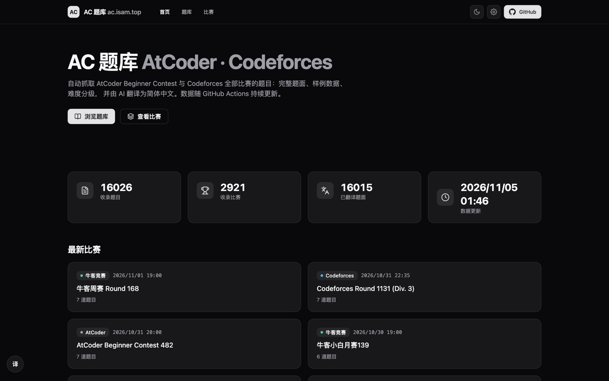 |
| T2 | 题库浏览页:列表 / 平台 tab / 难度筛选 / 计数 | ✅ | 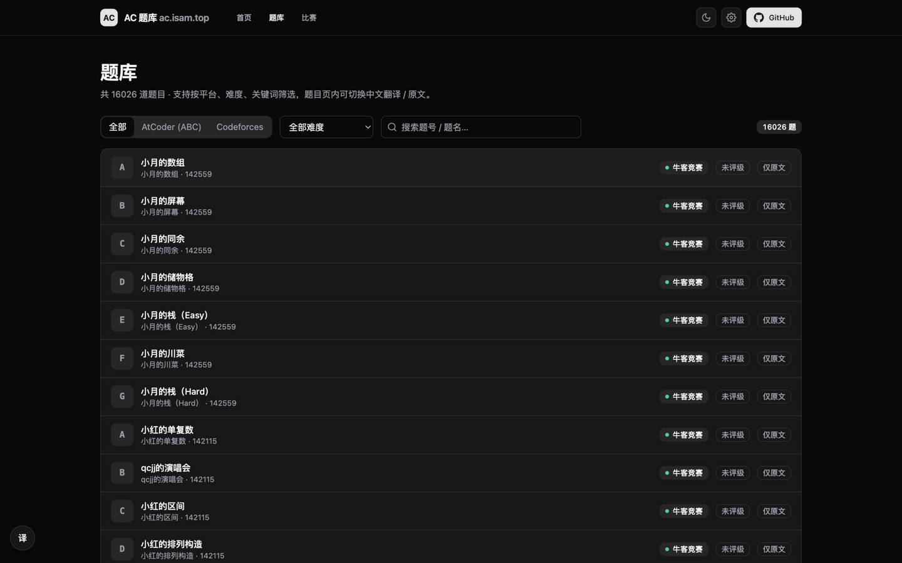 |
| T3 | 搜索过滤:`abc156_f` 精确命中 1 题 | ✅ | 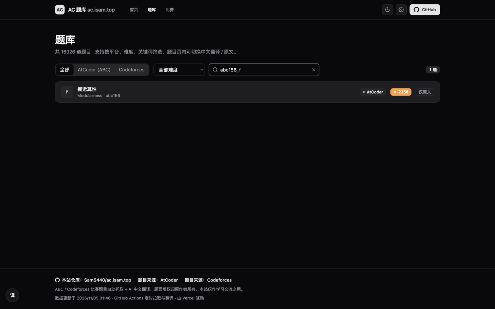 |
| T4 | **数学修复验证** abc156_f:57 KaTeX 0 错误、0 残留 token、cases 公式正常;题号切换条 / 侧栏 / 样例复制 | ✅ | 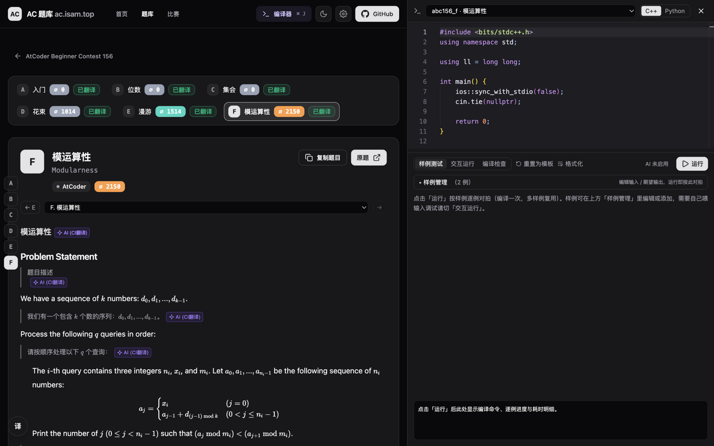 |
| T4b | 题面中部:代码块 / 样例区 / 编译器运行时加载 | ✅ | 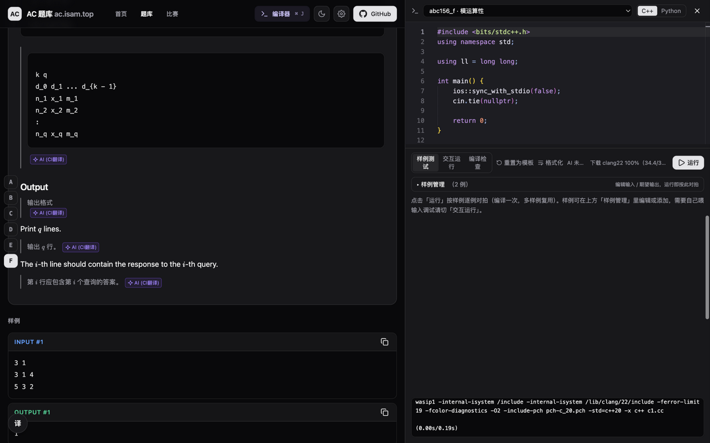 |
| T5 | 语言侧栏:8 模式(英文/DeepL/有道/彩云/讯飞/AI CI/AI 自定义/对照) | ✅ | 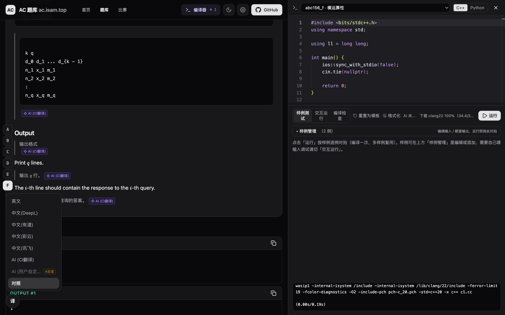 |
| T5b | 英文模式:译文块归零,32 KaTeX 0 错误 | ✅ | 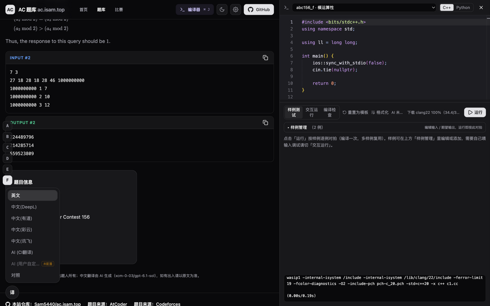 |
| T6 | 编译器:clang22 自动下载 100% → 编译 → 双样例对拍(空模板 WA 为预期,期望/实际对比正确) | ✅ | 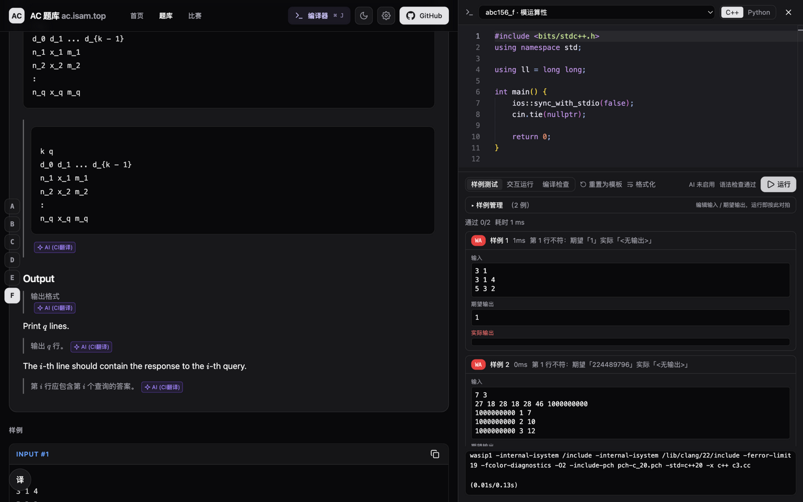 |
| T7 | 复制题目按钮:「✓ 已复制」反馈 | ✅ | 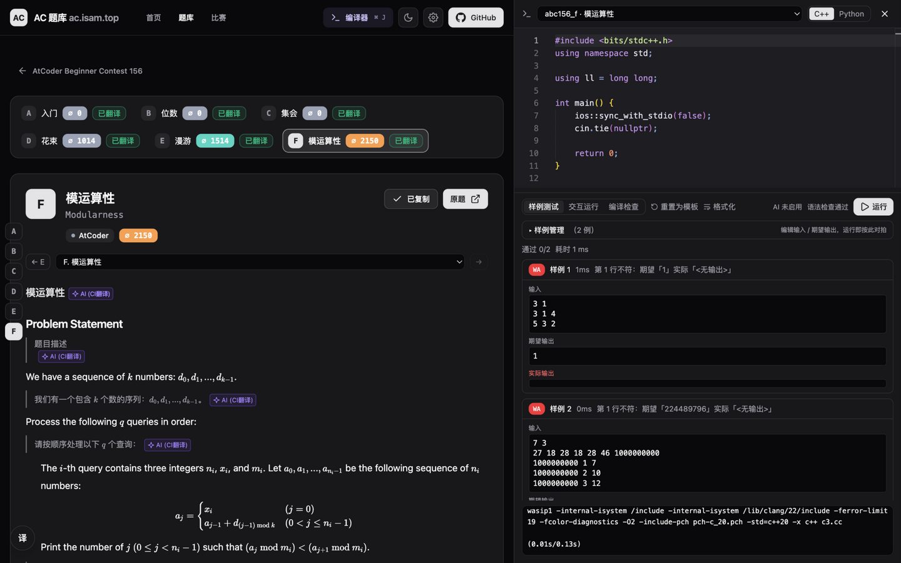 |
| T8 | 设置面板:外观/语言/优先级排序/样式/AI 接口/比赛类型/编译器运行时管理/更新日志 | ✅ | 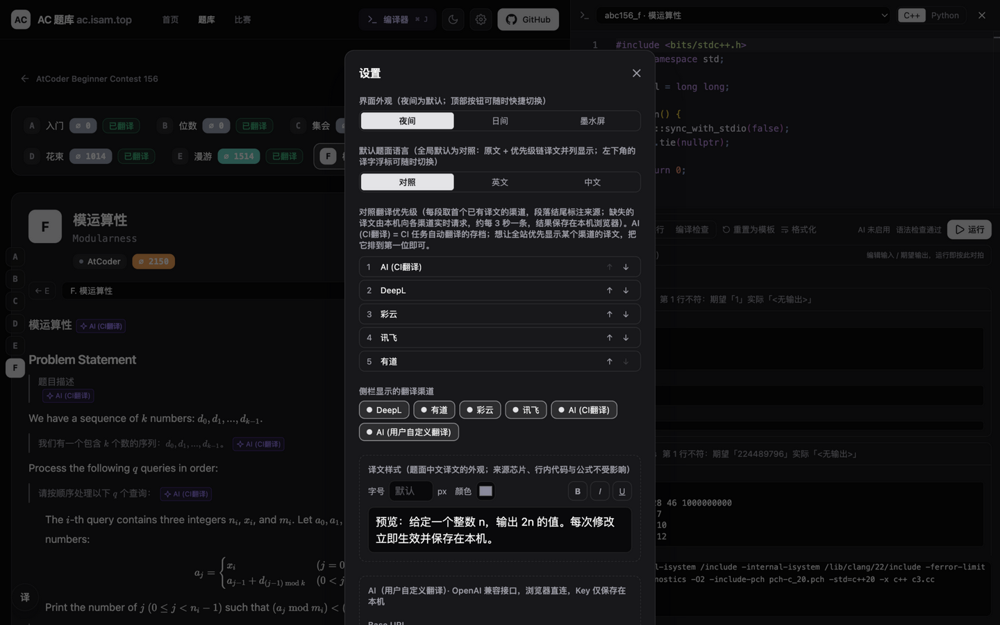 |
| T9 | **二次编码修复验证** abc139_d:无 JSON 源码、中文题名/译文正常、24 KaTeX 0 错误 | ✅ | 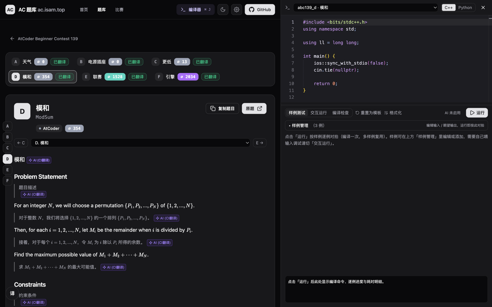 |
| T10 | **array 修复验证** CF 1431i:58 KaTeX 0 错误,矩阵正常 | ✅ | 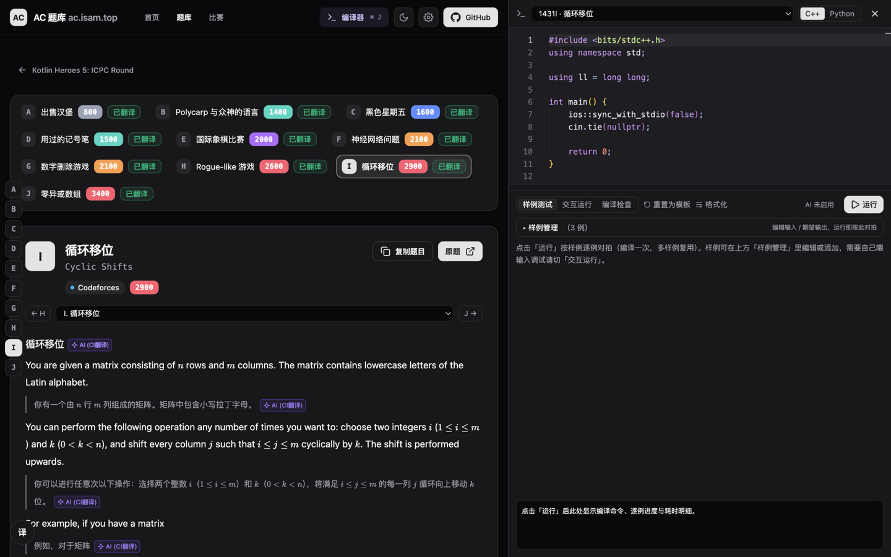 |
| T11 | 404 页:优雅降级 + 返回首页 | ✅ | 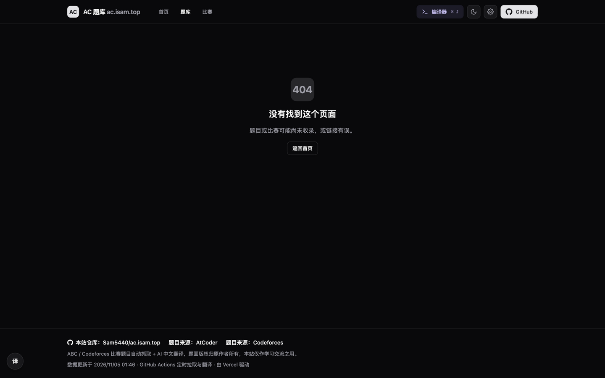 |
| T12 | 主题三态循环:夜间→日间→墨水屏→夜间,aria-label 动态更新 | ✅ | 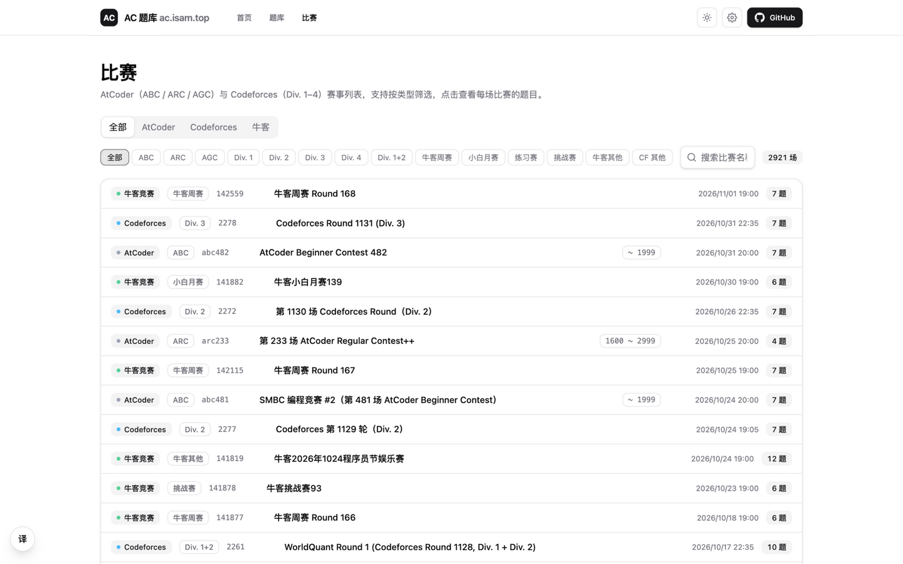 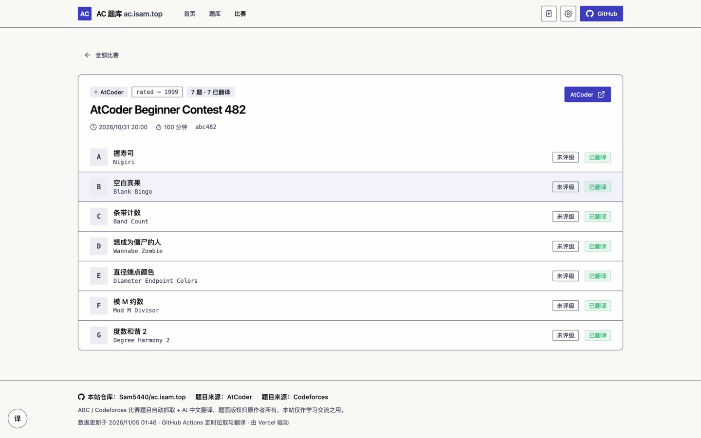 |
| T13 | 比赛列表(平台/类型筛选/搜索)+ 比赛详情(7 题 7 已翻译) | ✅ |  |

> 测试过程备注:T12 恢复夜间主题时 aria-label 定位两次超时,改用坐标点击成功——为测试工具的 role-name 匹配问题,按钮功能本身正常(三种主题均正确切换并持久化)。

---

## 五、变更文件清单

**代码(4 个)**:
- `lib/render.js` — 新增 `sanitizeText` / `normalizeMathMarks`,渲染入口接入;公式提取 tab 归一
- `scripts/lib/atcoder.mjs` — 题面入库前同口径清洗归一
- `scripts/lib/cf.mjs` — `normalizeCfMath` 接入 `sanitizeText`
- `scripts/lib/llm.mjs` — `parseLenientJson` 修复含控制字符/未转义引号的 LLM JSON 解析(483 题根因)

**数据(约 486 个题目文件)**:471 题二次编码修复 + 9 题截断置空 + 3 题字面 `\n` + 2 题定界符混用 + 1 题(1431i)array 列规格;另 `data/index.json` 已重建。
(工作区中其余 `data/` 修改为此前翻译批次的既有未提交改动,与本次测试修复无关。)

**建议提交拆分**:`fix: render sanitize + math delimiter normalization`(代码)/ `fix: repair double-encoded zh translations`(数据)。
